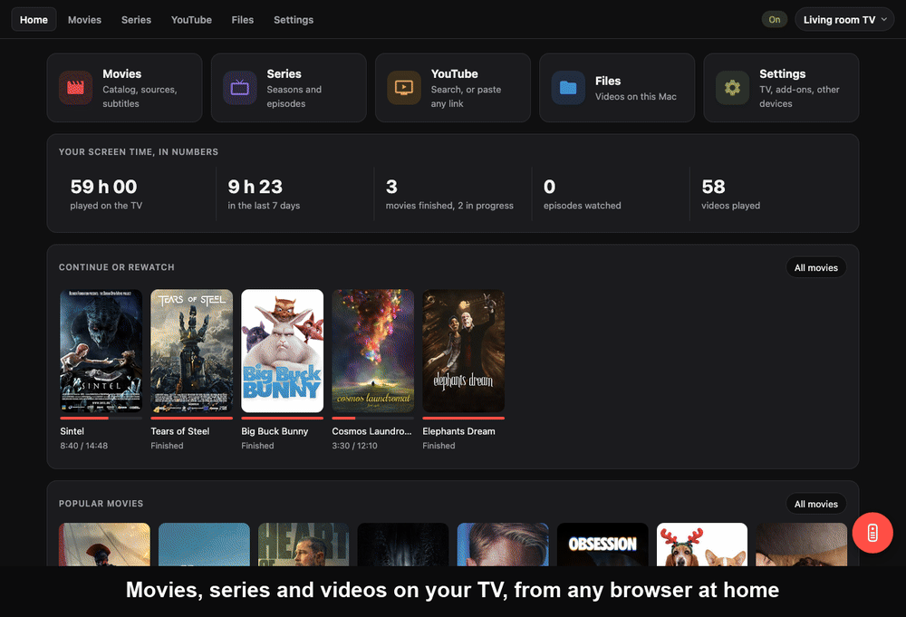

# mac-to-tv

**Your movies, series and videos on the TV you already own, driven from any browser at home.**

A Mac on your network becomes a small media center: you pick something in a web page, on a laptop or a phone, and it
plays on the TV. No box to buy, no app to install on the TV, no account.



<sub>The movie in the player is [Sintel](https://durian.blender.org), © Blender Foundation, CC BY 3.0.</sub>

## What you get

- **A catalog of movies and series**, with search, genres, posters and descriptions. Each one has its page; series are
  listed season by season, with what you have already watched.
- **No waiting for a download.** A movie plays while it downloads, and the player shows how far ahead the download
  is.
- **Subtitles that fit.** Pick a language: the best matching file is chosen, and it is checked against the movie while
  you watch. If it is early, late, or made for another frame rate, it is put right by itself when the answer is
  clear. Two buttons do the rest.
- **Pick up where you stopped**, on every movie and every episode, even after closing the page.
- **YouTube without ads**, and many other video sites: search from the page, or paste a link.
- **Your own files**: the videos of a folder on the Mac, one click away.
- **Watch in the browser instead**, when the TV is taken: same catalog, same subtitles. A button sends it to the TV at
  the same second when it is free again.
- **The page is the remote.** Play, pause, seek, volume; and on supported TVs, power, backlight and picture mode. On a
  phone, scan a QR code and it is in your pocket.
- **It runs at home.** The server is your Mac, on your local network: no account, and no service of ours in between.
  It only goes out to fetch what you ask for: the catalog, the subtitles, the videos.

## Does it work with my TV?

Probably: it needs a TV with a **DLNA** network player, which most smart TVs have (Samsung, LG, Sony, Philips,
Panasonic, Grundig, Beko…). The page finds the TVs on your network and tells you what will work on each.

- It has been developed and used daily on one TV, a **Grundig Ultralogic 4K**. Other DLNA TVs should play the same
  way but have not been verified: [tell us how yours does](CONTRIBUTING.md).
- The full remote (power, backlight, picture mode) exists for Grundig and Beko TVs; other brands get volume and mute.
- Chromecast, Apple TV and Fire TV are not supported.
- **No TV at all?** Everything also plays in the browser.

## Get started

You need a Mac that stays on while you watch, on the same network as the TV, with [Homebrew](https://brew.sh).

```sh
brew install yt-dlp ffmpeg ffmpeg-full
git clone https://github.com/Edracoon/mac-to-tv.git && cd mac-to-tv
mkdir -p bin && curl -L -o bin/TorrServer \
  https://github.com/YouROK/TorrServer/releases/download/MatriX.147.2/TorrServer-darwin-arm64 && chmod +x bin/TorrServer
python3 server.py
```

Open <http://127.0.0.1:8765>, choose your TV, and play something. (Intel Mac: take `TorrServer-darwin-amd64`.)

- To use it from a phone or another computer: `python3 server.py --lan`, then scan the QR code shown in the page.
- To leave it running for good: `./service.sh install`.
- The catalog and the subtitles come from two add-ons set up by default. **No source of movies is included**: you add
  the source add-ons of your choice in Settings. mac-to-tv ships no content; what you play with it is up to you.

The full guide (every option, running as a service, access from other devices, security) is in
[docs/guide.md](docs/guide.md).

## Good to know

- macOS only for now ([Linux is on the list](https://github.com/Edracoon/mac-to-tv/issues/15)).
- The interface is in English.
- It is a personal project, built for one living room and shared as is. It has tests, including a fake TV that the
  whole thing is run against, but only one real TV behind it.

## Going further

| | |
|---|---|
| [docs/guide.md](docs/guide.md) | Installing, running, leaving it on, phones, security, what is kept where |
| [docs/how-it-works.md](docs/how-it-works.md) | What happens behind each button, what was measured, the known limits |
| [CONTRIBUTING.md](CONTRIBUTING.md) | Testing your TV, fixing playback on it, writing a remote for your brand |
| [Issues](https://github.com/Edracoon/mac-to-tv/issues) | What is planned, what is broken |
